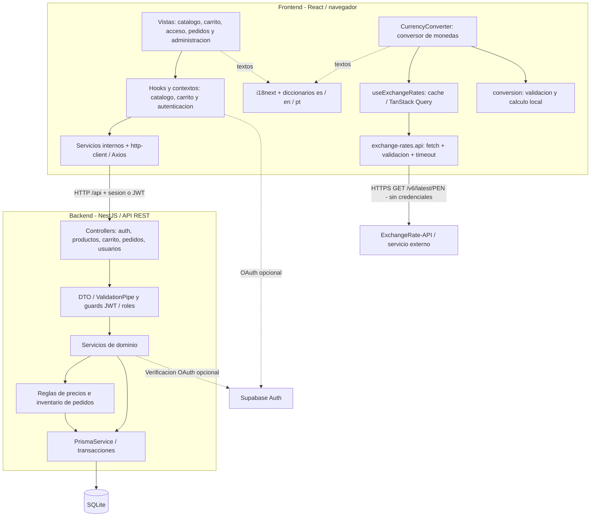

# Diagrama de componentes: Tienda Virtual

## Diagrama UML


- [Imagen vectorial ampliable (SVG)](../output/diagrams/diagrama-componentes.svg).
- [Fuente editable PlantUML](diagrama-componentes.puml).

Los rectangulos con el simbolo UML representan componentes; los circulos son
interfaces proporcionadas. Las dependencias discontinuas apuntan del cliente al
proveedor. La integracion Supabase es opcional. Las clases se agrupan por
responsabilidad: no se pretende representar cada clase como un componente.

Generacion local con Java y PlantUML 1.2026.8 (motor Smetana, sin Graphviz):

```powershell
java -jar tmp/plantuml-java8-1.2026.8.jar -charset UTF-8 -tpng -o ../output/diagrams docs/diagrama-componentes.puml
java -jar tmp/plantuml-java8-1.2026.8.jar -charset UTF-8 -tsvg -o ../output/diagrams docs/diagrama-componentes.puml
```

El renderizador se obtuvo de la distribucion oficial de PlantUML y se verifico
su SHA-256. La generacion es local: el codigo del proyecto no se envia a un
servidor de diagramas. El JAR de `tmp/` es una herramienta temporal, no una
dependencia de la aplicacion.

## Vista simplificada

Las flechas indican dependencias o llamadas. Cada bloque agrupa una responsabilidad;
no representa un microservicio. React y NestJS son dos aplicaciones del monorepo.



## Como leerlo

1. **Interfaz:** recibe acciones y presenta resultados. `App.tsx` registra las rutas
   y `Navbar.tsx` permite abrir el conversor en `/currency`.
2. **Estado:** los hooks y contextos coordinan los servicios sin mezclar JSX con
   transporte HTTP. El conversor utiliza su propio hook, independiente del carrito.
3. **API propia:** Axios llama a NestJS mediante `/api`. Nest valida entradas y permisos,
   ejecuta los casos de uso y accede a SQLite mediante Prisma.
4. **API externa:** el navegador consulta directamente ExchangeRate-API. No pasa por
   Nest ni por el proxy de Vite. El importe se calcula localmente y no sale al proveedor.
5. **Internacionalizacion:** los diccionarios traducen la interfaz, sin modificar datos
   almacenados ni cambiar la moneda contable PEN.

## Componentes y archivos

| Componente | Archivo o directorio | Responsabilidad |
| --- | --- | --- |
| Rutas y navegacion | `frontend/src/App.tsx`, `components/Navbar.tsx` | Acceso a cada pantalla |
| Conversor | `frontend/src/components/CurrencyConverter.tsx` | Campos, resultado y estados accesibles |
| Consulta y cache | `frontend/src/modules/currency/useExchangeRates.ts` | Cache en memoria de una hora |
| Reglas puras | `frontend/src/modules/currency/conversion.ts` | Validacion regex del importe y multiplicacion |
| Adaptador externo | `frontend/src/services/exchange-rates.api.ts` | Fetch publico, validacion de JSON y errores |
| Transporte interno | `frontend/src/services/http-client.ts` | API propia con sesion/JWT |
| Idiomas | `frontend/src/i18n.ts`, `frontend/src/locales/` | Espanol, ingles y portugues |
| Backend | `backend/src/{auth,products,cart,orders,users}/` | Controllers, DTO, guards y servicios |
| Persistencia | `backend/src/prisma/`, `backend/prisma/schema.prisma` | Prisma y modelo SQLite |

El recorrido Controller -> validacion -> servicio es conceptual: Nest ejecuta los
guards y pipes antes del metodo del controlador. Supabase es opcional y depende de
la configuracion OAuth. Los modulos billing/reviews existentes no se muestran por
no formar parte de este recorrido; no se representa una pasarela de pago implementada.

La version UML editable esta en [diagrama-componentes.puml](diagrama-componentes.puml).
El contrato y las pruebas estan en [servicio-externo.md](servicio-externo.md).
