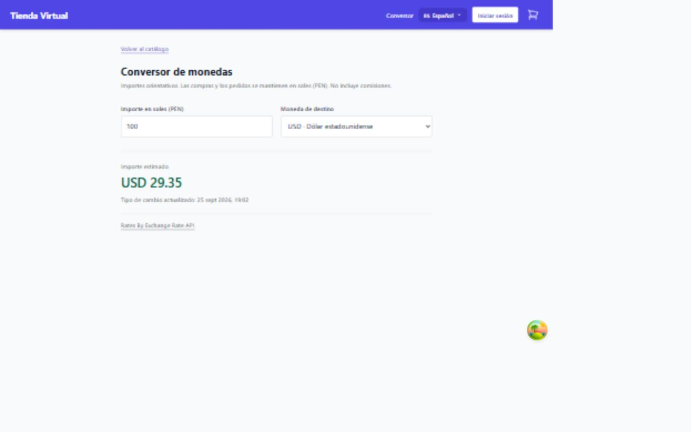
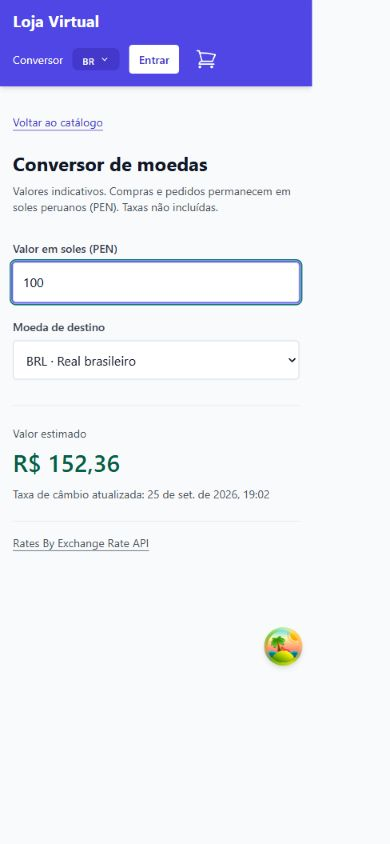

# Servicio externo consumido desde el frontend

## Objetivo

El conversor de `/currency` muestra una referencia del valor en USD, EUR o BRL de
un importe en soles peruanos. Los pedidos, el catalogo y los cobros no cambian de moneda.
Se reutilizan React, TypeScript, TanStack Query e i18next; no se agregan dependencias.

## Proveedor y contrato

- Proveedor: [ExchangeRate-API, Open Access](https://www.exchangerate-api.com/docs/free).
- Solicitud: `GET https://open.er-api.com/v6/latest/PEN` mediante `fetch` del navegador.
- Autenticacion: ninguna; esta modalidad no necesita API key.
- Respuesta: JSON con `result`, `base_code`, `rates`, `time_last_update_unix`
  y `time_next_update_unix`. El adaptador conserva USD, EUR y BRL.
- Datos publicados diariamente, no cotizaciones en tiempo real. La interfaz muestra
  la fecha del proveedor y avisa cuando paso la siguiente actualizacion prevista.
- El proveedor requiere atribucion; la vista incluye el enlace
  [Rates By Exchange Rate API](https://www.exchangerate-api.com).
- El acceso desde el navegador depende del CORS y disponibilidad del proveedor.
  No se usa `no-cors`, porque impediria leer la respuesta JSON.

## Flujo

1. `CurrencyConverter` monta `useExchangeRates`.
2. TanStack Query reutiliza la respuesta en memoria por una hora. La cache se pierde
   al recargar la pagina; no hay sondeo, reintento automatico ni consulta al enfocar la ventana.
3. `getExchangeRates` hace una solicitud HTTPS directa, cancelable y con limite de 10 segundos.
4. `parseExchangeRates` valida el JSON, la base PEN, fechas y tasas positivas y finitas.
   Un techo defensivo de 1 000 000 por tasa evita valores numericamente absurdos
   para estas tres monedas. No se confia solo en los tipos TypeScript.
5. `parseConversionAmount` acepta de 0 a 1 000 000, hasta dos decimales y separador
   punto o coma. Regex: `^\d+(?:[.,]\d{1,2})?$`; el limite se valida numericamente.
6. `convertAmount` multiplica el importe por la tasa en el navegador, en O(1).
   `Intl.NumberFormat` presenta dos decimales; este calculo no se usa para contabilidad.

Cambiar el importe, el idioma o la moneda destino no consulta otra vez al proveedor.
La cache pertenece al `QueryProvider` existente; no hay una segunda fuente de estado.

## Seguridad y errores

El adaptador externo no importa `http-client.ts`: ese cliente adjunta credenciales
de la tienda. El fetch publico solo envia `Accept: application/json`, omite cookies
y no envia referrer. No se transmiten el importe ingresado, JWT, carrito ni datos de
clientes. Como en toda conexion web directa, el proveedor recibe la IP del navegador.

Hay mensajes traducidos para desconexion, timeout, HTTP 429, otros errores HTTP y
JSON invalido. El boton de reintento permite recuperar la consulta, sin ocultar el
fallo. Si ya habia datos en cache y falla una actualizacion, se conservan con una
advertencia. Los errores no se convierten en una tasa inventada o un resultado cero.
Al desmontarse la vista, la consulta pendiente se cancela.

## Ejecucion y prueba

Desde la raiz del repositorio:

```powershell
npm run dev
npm test
npm run build
```

Abrir `http://localhost:5173/currency` (o el puerto que indique Vite).

1. Ingresar `100` y alternar USD/EUR/BRL; observar resultado y fecha.
2. Ingresar `12,50`, luego `-1` y `1.234`; los dos ultimos deben mostrar error.
3. Cambiar entre espanol, ingles y portugues desde el menu.
4. En DevTools > Network, buscar `open.er-api.com`: la solicitud debe salir del
   navegador hacia el proveedor, no hacia `/api`. No debe tener Authorization ni
   x-session-id. Cambiar importe o moneda no debe generar nuevas consultas.
5. Bloquear ese dominio en DevTools y recargar: debe aparecer un error y la opcion
   de reintento. Quitar el bloqueo y reintentar para recuperar la consulta.

`frontend/test/exchange-rates.test.cjs` prueba contrato, transporte, errores,
cancelacion, timeout, limites y conversion con respuestas simuladas, sin consumir
cuota. Estas pruebas no sustituyen la comprobacion real de conectividad y CORS.

Ver [diagrama de componentes](diagrama-componentes.md) para ubicar el modulo.

## Evidencia de ejecucion (26 de septiembre de 2026)

La comprobacion en el navegador recibio datos reales del proveedor, sin mocks:
100 PEN mostro USD 29.35 y BRL 152.36; 12,50 PEN mostro EUR 3.22. Son resultados
observados en esa prueba, no valores fijos de la aplicacion ni tasas garantizadas.
La fecha publicada que mostro la interfaz fue 25 de septiembre, 19:02 (hora local).

Se comprobaron los tres idiomas, el rechazo de un importe negativo y la ausencia
de desplazamiento horizontal en viewports de 1280 x 800 y 390 x 844. Los errores
de red, timeout y HTTP se comprobaron en las pruebas automatizadas con mocks;
no se provoco una interrupcion real del proveedor durante la prueba visual.




