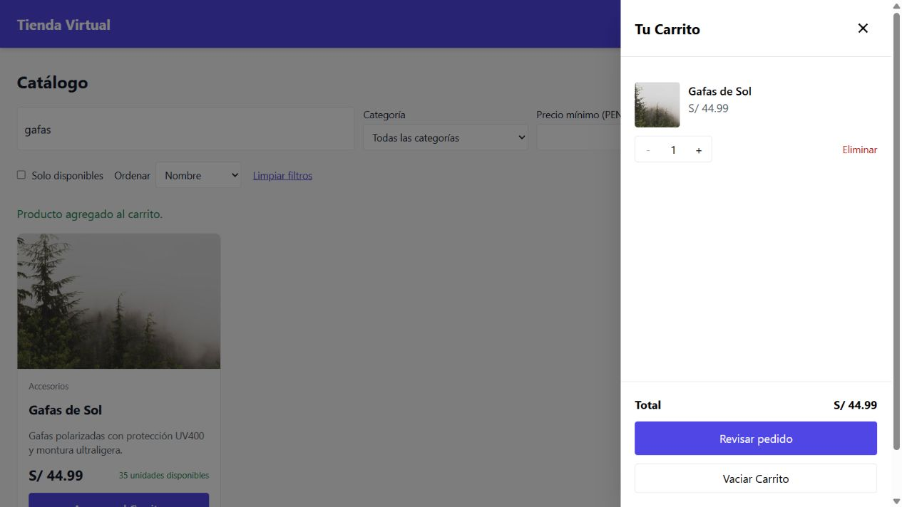
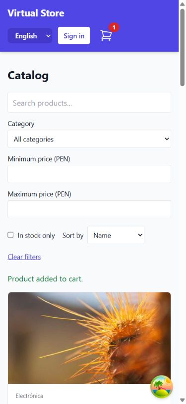

# Cambios y verificacion

## Arranque local

1. Instalar dependencias con `npm install` en la raiz.
2. Configurar `backend/.env` a partir de `backend/.env.example`. Generar una clave
   JWT con `node -e "console.log(require('node:crypto').randomBytes(48).toString('hex'))"`.
   No publicar esa clave. El servidor rechaza claves ausentes, cortas o de ejemplo.
3. Ejecutar `npm run db:generate`. Para una base SQLite nueva, ejecutar desde
   `backend`: `npx prisma db push`, y desde la raiz `npm run db:seed`.
4. Ejecutar `npm run dev` desde la raiz. Frontend: http://localhost:5173.
   API: http://localhost:3001/api. Swagger: http://localhost:3001/api/docs.

La base local existente se respaldo antes de agregar perfiles y pedidos.
`backend/prisma/updates/20260910_orders.sql` documenta la actualizacion aplicada
a esa base; no volver a ejecutarla sobre tablas ya creadas. No elimina tablas.
El esquema Prisma actual utiliza SQLite; PostgreSQL requiere su propia migracion.

## Comportamiento

- Catalogo publico, filtros locales, ficha de producto y mensajes de carga/error.
- Interfaz en espanol e ingles, seleccion persistente y moneda PEN con formato
  regional. Cambiar idioma no convierte precios ni traduce contenido del catalogo.
- Registro e inicio local, restauracion de sesion y rutas privadas.
- OAuth es opcional: configurar el mismo proyecto Supabase en ambos servicios,
  habilitar proveedores y autorizar `/auth/callback` como redireccion.
  Solo `app_metadata.role` de un token verificado puede otorgar el rol admin;
  nunca `user_metadata`. Las cuentas locales nuevas son clientes.
- El carrito requiere `x-session-id` UUID. Las mutaciones validan cantidades,
  disponibilidad y pertenencia al carrito.
- Checkout requiere inicio de sesion. Crea un pedido `pending_payment`, reserva
  stock y vacia el carrito en una transaccion. Repetir el mismo `requestId`
  devuelve el mismo pedido sin volver a descontar existencias.
- Cada cliente puede ver y cancelar sus propios pedidos pendientes. Cancelar
  restituye existencias una sola vez. No hay pasarela, cobro ni envio automatico.
  Las reservas no caducan automaticamente: se liberan al cancelar.

## Pruebas

`npm test` ejecuta pruebas de frontend y backend. Las regresiones HTTP inician
Nest con una base SQLite aislada en `backend/test/.tmp` y una
clave JWT aleatoria; no modifica la base de desarrollo. Comprueba permisos,
sesion, validacion, administracion, concurrencia del carrito, idempotencia de
pedidos, rollback por falta de stock y cancelacion sin doble restitucion.

`npm run build` compila frontend, backend y tipos compartidos.

El acceso a proveedores OAuth reales y los cobros requieren configuracion externa
y no forman parte de las pruebas automatizadas locales.

## Refactorizacion modular (2026-09-13)

21 pruebas: 15 backend y 6 frontend. Los modulos de calculo, filtrado,
almacenamiento y transporte se comprueban aisladamente. Ver
[arquitectura y puntos de extension](architecture.md).

Comprobacion manual en navegador: busqueda, limpieza de filtros, agregado al
carrito, cantidad y total, cambio de idioma y viewport movil de 390 x 844 sin
desbordamiento horizontal. No se registraron errores de consola en ese recorrido.
Las fotografias del catalogo siguen siendo datos de muestra, no fotos verificadas
de los productos. No se ejecuto un cobro ni OAuth real.

